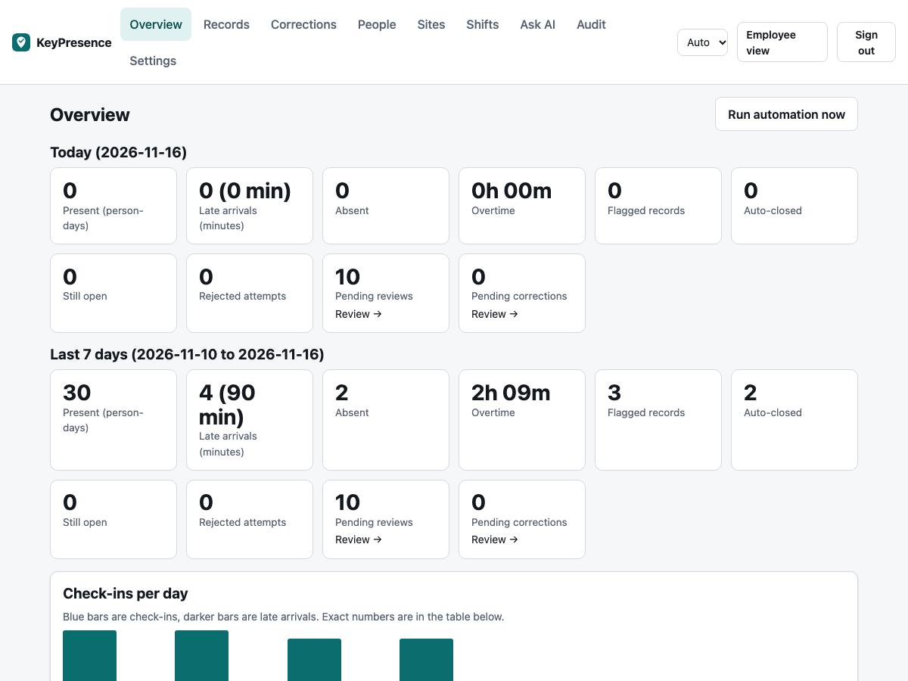
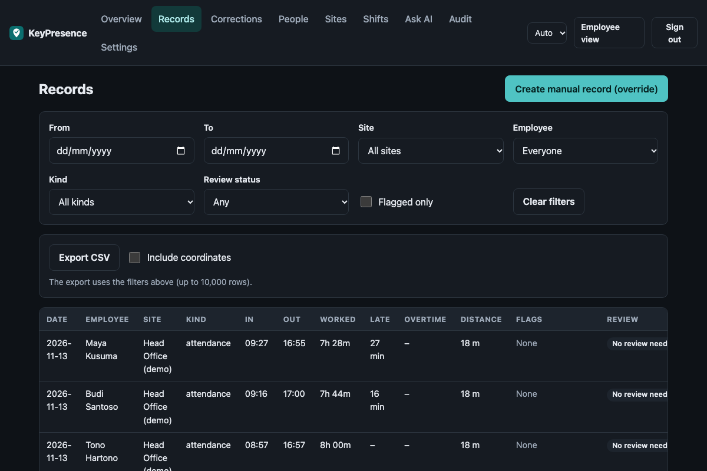
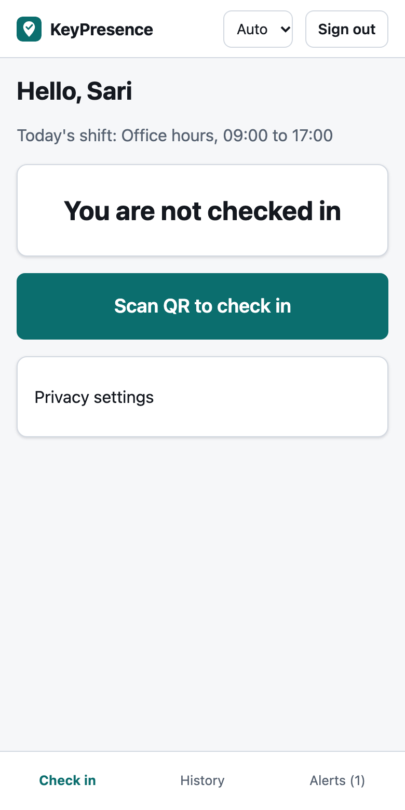

# KeyPresence

Location-verified check-in and check-out for anything, not only work attendance. An employee scans the **daily signed QR code of a site**; the app reads their position once and accepts, flags or rejects the check-in against that site's **geofence**. The same flow handles visitors, events, rooms/assets and tasks. Admins get a CMS, automatic late/overtime/absence detection, summaries, CSV export and a read-only, pseudonymised AI assistant.

This is a from-scratch redesign of an older attendance app, built as a portfolio project with Claude Code doing most of the typing and most of the checking. [`docs/ai-usage.md`](docs/ai-usage.md) says exactly where, and [`docs/STATUS.md`](docs/STATUS.md) lists what is verified and what is not.

| Admin overview (light) | Records (dark) | Employee phone view |
| --- | --- | --- |
|  |  |  |

## Run it

Needs Node 22+ (developed on Node 26.13). No Docker and no database install are required.

```bash
npm install
npm run demo
```

Open <http://localhost:8787>. The demo seeds fictional people, two sites and 14 days of history, then serves the built web app and the API from one process. Data is kept in `.data/pglite` (embedded PostgreSQL via PGlite).

| Role | Email | Password |
| --- | --- | --- |
| Admin | `admin@keypresence.test` | `demo-password-1` |
| Employee | `sari@keypresence.test` (also budi, rina, dewi, agus, maya, tono, lina) | `demo-password-1` |

All names are invented and `.test` is a reserved domain. The password is a demo value, never use it elsewhere.

**Try the demo flow:** sign in as admin, *Sites* → *QR code* for "Head Office (demo)" and copy the link. Sign in as Sari on a phone or another browser window, open the link, press *Check in*. Browsers only allow location on `localhost` or HTTPS, so for a phone use a tunnel or deploy over HTTPS. In desktop Chrome DevTools, *Sensors → Location* sets a fake position; the Head Office fence is centred on `-6.175392, 106.827153` (radius 120 m). Move the position 1 km away and the check-in is rejected with the distance.

### Other commands

| Command | What it does |
| --- | --- |
| `npm run dev` | API (watch) on :8787 plus Vite on :5173, proxying `/api`. Copy `.env.example` to `.env` first. |
| `npm run seed` / `npm run seed -- --reset` | Seed (or wipe and reseed) the configured database. |
| `npm run jobs:run` | Run the automation jobs once (for cron). The server also runs them every 60 s unless `JOBS_IN_PROCESS=0`. |
| `npm test` | Unit, API, jobs, AI guardrail, privacy and contrast tests on PGlite. |
| `npm run test:pg` | Same suite on a real PostgreSQL (`TEST_DATABASE_URL`, default `postgres://localhost:5432/keypresence_test`). |
| `npm run test:e2e` | Playwright: builds the app, starts it on :8788 and drives the real UI. |
| `npm run typecheck` | `tsc --noEmit`. |
| `bash scripts/mutation-check.sh` | Disables 14 guards one at a time and checks the tests notice. |
| `docker compose up -d` | Optional PostgreSQL 17; then set `DATABASE_URL`. |

## What it does

- **Check-in/out with QR + location.** Both legs need today's valid QR and a fix inside the site's fence. Rejections explain why (distance, accuracy, expired QR). Every attempt is recorded without coordinates.
- **Per-site geofence and enforcement.** Radius, accuracy threshold, and a mode per site: reject outside the fence, accept but flag, or no location check.
- **Anti-spoofing signals.** Stale fix, accuracy under 1 m, round-number coordinates, a native mock hint, and impossible travel between events. They are flagged for review, or rejected if the admin sets `spoofing_action = reject`. The limits of this are in [ADR-0005](docs/adr/0005-anti-spoofing.md).
- **Signed daily QR per site.** `HMAC-SHA256` over site, local day and a rotation epoch, with a per-site secret under a server master secret. Old codes are rejected; admins can display, print and rotate ([ADR-0004](docs/adr/0004-qr-token.md)).
- **Generic events.** `attendance`, `visitor`, `event`, `asset`, `task` share one table, one QR and one geofence. Lateness and overtime apply to attendance only.
- **Admin CMS.** Employees, sites, shifts, records with review queue, manual override (reason required, audited), corrections with approvals, settings, audit log, CSV export (formula-injection safe, coordinates only on request and audited).
- **Automation.** Late/overtime from shift rules, absence detection, auto-closing forgotten check-outs, reminders, daily and weekly summaries, retention. All idempotent; see `src/server/jobs/index.ts` and `tests/jobs.test.ts`.
- **AI assistant (admin only).** Natural-language questions and anomaly explanations. The model never sees data or writes SQL: a question becomes a validated JSON plan, run as fixed parameterised SQL in a read-only transaction; employees appear as aliases; output is scanned for PII ([ADR-0007](docs/adr/0007-ai-guardrails.md)). Works offline with a rule-based planner; an LLM planner is optional.

## Architecture

```
React PWA (Vite) ──/api──▶ Hono API ──▶ domain rules (pure, tested) ──▶ PostgreSQL | PGlite
                              │                  geo.ts  qr.ts  shifts.ts  summary.ts
                              ├── jobs (every 60 s or `npm run jobs:run`)
                              └── ai: planner ▶ zod whitelist ▶ read-only SQL ▶ alias ▶ scanner
```

Decisions: [stack](docs/adr/0001-stack.md) · [auth](docs/adr/0002-auth.md) · [data model](docs/adr/0003-data-model.md) · [QR token](docs/adr/0004-qr-token.md) · [anti-spoofing](docs/adr/0005-anti-spoofing.md) · [privacy](docs/adr/0006-privacy.md) · [AI guardrails](docs/adr/0007-ai-guardrails.md). Requirements and non-goals: [`docs/requirements.md`](docs/requirements.md).

## Measured

All numbers are from this repository on one MacBook (macOS 27.2, Node 26.13, PostgreSQL 17.11 via Homebrew), run on the date of the last commit. They are local and in-process, not a load test.

| Claim | How to reproduce | Result |
| --- | --- | --- |
| Test count | `npm test` | **190 passed** in 10 files (also 190 passed on real PostgreSQL 17 with `npm run test:pg`) |
| End-to-end + accessibility | `npm run test:e2e` | **4 passed**: demo flow, dark/mobile layout, axe scan of 13 pages in light and dark with no serious or critical violations |
| Guard mutation check | `bash scripts/mutation-check.sh` | **14 of 14** mutations caught |
| Contrast | `tests/contrast.test.ts` | 15 text/background pairs at 4.5:1 or better in light, dark(auto) and dark(manual) |
| API latency, check-in / check-out | `npx tsx scripts/bench.ts` | PGlite p50 1.2 / 1.4 ms, p95 1.6 / 1.8 ms; Postgres 17 p50 0.9 / 0.9 ms, p95 1.9 / 1.9 ms (100 cycles, in-process, no network) |
| Summary over 15 days / AI question | same | p50 2.0 / 0.9 ms (PGlite), 1.1 / 0.7 ms (Postgres) over a 14-day, 8-person seed |
| Web bundle (gzip) | `npm run build` | main chunk 140 KB (React, router, QR decoder), each admin page 1-4 KB lazy-loaded, CSS 2.4 KB |
| Concurrency | `tests/checkin.api.test.ts` | 8 simultaneous check-ins by one user produce exactly 1 open record (unique partial index), on both PGlite and Postgres. PGlite serialises queries, so the Postgres run is the meaningful one. |

## Security and privacy in practice

- Passwords: scrypt. Sessions: random token in an `HttpOnly` cookie, only its SHA-256 stored. CSRF: JSON-only mutations plus `Origin` check. Login rate limit (in-process).
- Location is read once per check-in, never in the background, behind a consent screen. Coordinates are stripped after `coord_retention_days` (default 90) by the retention job; attempts never store coordinates. Request logs contain no bodies, query strings or tokens (tested).
- The service worker caches the app shell only, never API data.

## Limitations (read these)

- **A determined spoofer wins.** A browser cannot tell a real GPS fix from a mock one. The system raises the cost and leaves evidence; it does not prevent fraud. A colleague who scans for you while standing in the fence with your session is also not detected.
- **Absence is an upper bound.** There is no leave model; "absent" means no attendance check-in on a working day.
- One organisation, one timezone. Overnight shifts are not supported. Admin and employee roles only.
- The login rate limiter and the job scheduler are per process. Run one instance, or run `jobs:run` from a single cron.
- Camera QR scanning, GPS on real phones, installing the PWA, the print layout of the QR page, and the optional LLM planner have **not** been verified on real devices or against the live API [UNVERIFIED]. The QR image decode is tested with the same library in Node.
- No email or push notifications; notifications are in-app only.
- Not deployed anywhere. Deployment (HTTPS is required for geolocation) is a later step; the app is a single Node process plus PostgreSQL.
- Not legal advice: the privacy design follows common data-protection principles, but its sufficiency for any jurisdiction is [UNVERIFIED].

## Layout

```
docs/            requirements, ADRs, ai-usage, STATUS, screenshots
migrations/      SQL migrations
src/server/      API, domain rules, jobs, AI layer, seed
src/web/         PWA (employee/ and admin/ screens)
tests/ e2e/      Vitest and Playwright
scripts/         seed, bench, mutation check, icons, screenshots
```
